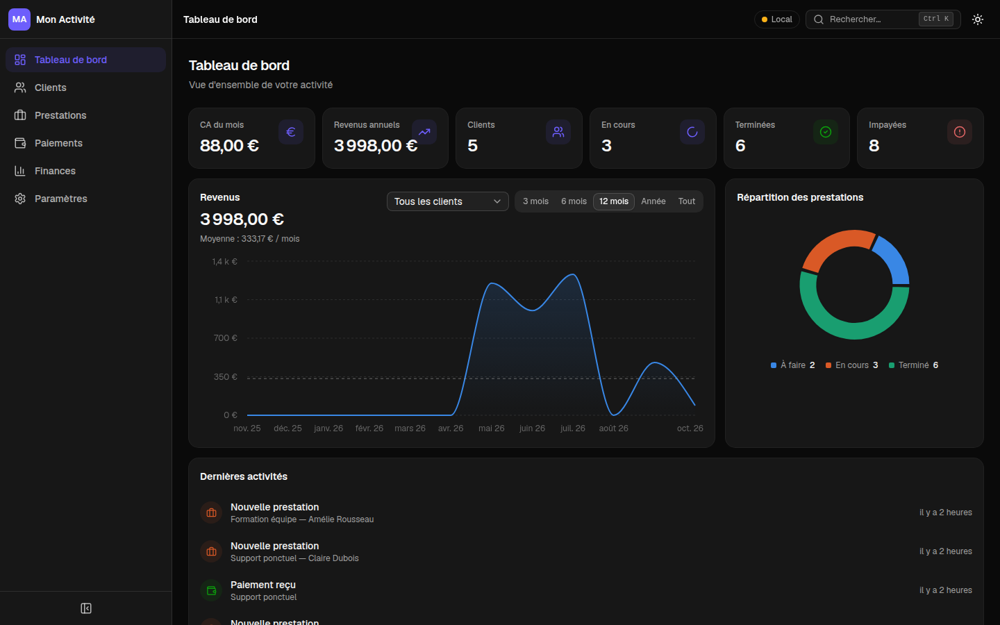

# SkyCRM

**Le CRM simple pour indépendants et petites structures : vos clients, vos prestations, vos paiements et vos finances au même endroit, sur ordinateur comme sur téléphone.**



## Ce que SkyCRM vous apporte

- **Savoir où vous en êtes en un coup d'œil** : chiffre d'affaires du mois et de l'année, prestations en cours, impayés, évolution de vos revenus.
- **Ne plus oublier un paiement** : chaque prestation affiche ce qui a été réglé et ce qui reste dû.
- **Connaître votre vrai bénéfice** : revenus moins dépenses, y compris les dépenses récurrentes (abonnements, hébergement…) ajoutées automatiquement.
- **Retrouver vos données partout** : avec la base en ligne, ce que vous saisissez sur votre ordinateur apparaît sur votre téléphone.
- **Garder la main sur vos données** : export Excel ou JSON à tout moment, et import de vos fichiers Excel existants.
- **Gratuit et open source** : hébergeable gratuitement sur Vercel et Supabase.

## Fonctionnalités

| | |
|---|---|
| **Tableau de bord** | Indicateurs clés, courbe des revenus filtrable par période (3 / 6 / 12 mois, année, tout) et par client, évolution par rapport à la période précédente, répartition des prestations, dernières activités |
| **Clients** | Fiche complète (contact, entreprise, adresse, notes), email de bienvenue automatique |
| **Prestations** | Prix, dates, échéance, statut (à faire, en cours, terminée) et statut de paiement calculé automatiquement |
| **Paiements** | Paiements partiels ou complets rattachés à une prestation, email de confirmation envoyé au client |
| **Finances** | Revenus, dépenses et bénéfices par mois et par année, meilleurs clients, dépenses récurrentes (quotidiennes, hebdomadaires, mensuelles) |
| **Recherche** | Recherche instantanée (`Ctrl K`) par nom, email, téléphone ou prestation, sans se soucier des accents |
| **Devises** | Euro, dollar US, livre sterling, franc suisse, dollar canadien, avec conversion automatique au taux du jour de la BCE |
| **Import / export** | Export Excel et JSON, import Excel avec reconnaissance automatique des colonnes |
| **Personnalisation** | Nom et logo de votre activité, couleur d'accent, mode clair ou sombre |
| **Application installable** | Ajoutez SkyCRM à l'écran d'accueil de votre téléphone ou ordinateur, comme une application |

## Démarrage rapide

Prérequis : [Node.js](https://nodejs.org) 20.19 ou plus (ou 22.12 et plus).

```bash
git clone https://github.com/Claude7776/SkyCrm.git
cd SkyCrm
npm install
npm run dev
```

Ouvrez http://localhost:5173. Sans configuration, SkyCRM fonctionne **en local** : les données restent dans votre navigateur et des données de démonstration sont ajoutées au premier lancement. Le badge **Local** en haut de l'écran l'indique.

## Synchroniser vos données entre appareils (Supabase)

Pour retrouver vos données sur tous vos appareils, connectez SkyCRM à une base [Supabase](https://supabase.com) gratuite. Vous accédez alors à l'application avec un email et un mot de passe, et chaque compte ne voit que ses propres données.

Le guide pas à pas (création des tables, de votre compte, variables à renseigner) est dans [supabase/README.md](supabase/README.md). Une fois connecté, le badge passe à **En ligne**. Les données déjà présentes dans votre navigateur sont transférées dans la base à la première connexion.

## Configuration

Copiez [.env.example](.env.example) en `.env.local` et renseignez les variables utiles. Ce fichier n'est jamais commité.

| Variable | Rôle |
|---|---|
| `VITE_SUPABASE_URL` | URL de votre projet Supabase |
| `VITE_SUPABASE_PUBLISHABLE_KEY` | Clé publique (publishable) de votre projet Supabase |
| `RESEND_API_KEY` | Clé [Resend](https://resend.com) pour les emails aux clients (côté serveur uniquement) |
| `RESEND_FROM_EMAIL` | Adresse d'expédition vérifiée dans Resend (facultatif) |

Toutes sont facultatives : sans Supabase, l'application reste en local. Sans Resend, les emails ne sont pas envoyés et vous pouvez les désactiver dans les Paramètres.

Les emails nécessitent aussi Supabase : la fonction d'envoi n'accepte que les utilisateurs connectés, pour que personne d'autre ne puisse utiliser votre compte Resend.

## Déploiement

SkyCRM est prévu pour [Vercel](https://vercel.com) : importez le dépôt, ajoutez les variables ci-dessus dans **Settings → Environment Variables**, puis déployez. La fonction [api/send-email.ts](api/send-email.ts) est déployée automatiquement pour l'envoi des emails.

Après avoir modifié une variable `VITE_…`, relancez un déploiement : elles sont intégrées au moment de la compilation.

## Stack technique

- [React 19](https://react.dev), [TypeScript](https://www.typescriptlang.org) et [Vite](https://vite.dev)
- [Tailwind CSS 4](https://tailwindcss.com) et [shadcn/ui](https://ui.shadcn.com) (Radix UI)
- [Recharts](https://recharts.org) pour les graphiques
- [React Hook Form](https://react-hook-form.com) et [Zod](https://zod.dev) pour les formulaires
- [Supabase](https://supabase.com) (PostgreSQL, authentification, Row Level Security)
- Fonctions serverless [Vercel](https://vercel.com) et [Resend](https://resend.com) pour les emails
- [vite-plugin-pwa](https://vite-pwa-org.netlify.app) pour l'installation en application

## Structure du projet

```
src/
├── pages/          Pages (tableau de bord, clients, prestations, paiements, finances, paramètres)
├── components/     Composants d'interface, regroupés par page
├── context/        Données de l'application et authentification
├── services/       Accès aux données (Supabase ou navigateur), import / export, emails, taux de change
├── hooks/          Calculs (statistiques, courbe des revenus, recherche)
└── utils/          Formatage, devises, couleurs, schémas de validation
api/                Fonction serverless d'envoi d'emails
supabase/           Schéma de la base et guide d'installation
```

## Scripts

| Commande | Rôle |
|---|---|
| `npm run dev` | Lance l'application en développement |
| `npm run build` | Vérifie les types et compile pour la production |
| `npm run preview` | Sert la version compilée en local |
| `npm run lint` | Analyse le code avec Oxlint |

## Licence

Distribué sous licence [MIT](LICENSE) : vous pouvez utiliser, modifier et redistribuer SkyCRM librement, y compris à des fins commerciales, en conservant la mention de copyright.
